# qdots: Biased-Noise-Tailored Quantum Error Correction Simulation Framework

A high-performance Python simulation framework engineered to benchmark and compare **Quantum Error-Correcting (QEC) codes** under realistic, biased physical noise models typical of **semiconductor spin qubits** (quantum dot architectures).

## 🔬 Core Scientific Objective

The flagship goal of this repository is to rigorously compare standard CSS codes against their **XZZX-deformed variants** to determine logical error rates versus syndrome extraction rounds ($P_L$ vs. rounds), compute fault-tolerant thresholds, and evaluate performance advantages under highly asymmetric (biased) noise.

### Supported Code Topologies
- **Surface Codes** (Rotated and Unrotated)
- **Bacon-Shor Codes** & Clifford-Deformed Bacon-Shor (CDBS) variants
- **XZZX Surface Codes**
- **Color Codes** (To do)

## 📊 Research Context & Status

Developed as part of my thesis and as advanced research into quantum error correction performance scaling for semiconductor spin qubits, in collaboration with UCR and NTHU. Designed to generate reproducible benchmarking data for threshold estimation and hardware-tailored decoder design.

## 🏛️ Framework Architecture

Beyond individual code benchmarks, `qdots` functions as a robust, easily configurable simulation pipeline designed for high-throughput scaling and custom noise model injection:

```mermaid
graph LR
    Config[/Config/] --> CG[Circuit generator]
    CG --> NI[Noise Injection]
    NI --> TG[Task generator]
    TG --> MC[Monte Carlo sampling]
    MC --> PP[Post processing]
    PP --> An[Analysis]

    style Config fill:#161b22,stroke:#30363d,color:#c9d1d9
    style CG fill:#161b22,stroke:#30363d,color:#c9d1d9
    style NI fill:#161b22,stroke:#30363d,color:#c9d1d9
    style TG fill:#161b22,stroke:#30363d,color:#c9d1d9
    style MC fill:#161b22,stroke:#30363d,color:#c9d1d9
    style PP fill:#161b22,stroke:#30363d,color:#c9d1d9
    style An fill:#161b22,stroke:#30363d,color:#c9d1d9
```



## Repository Structure

```text
.
├── README.md           # This file
├── requirements.txt    # Third-party dependencies
├── Makefile            # Automation commands (e.g., make run)
├── docs/               # Project documentation and github pages
└── src/                # Source code
    ├── main.py         # Application entry point
    ├── conf.py         # Simulation parameters and configuration
    ├── gen/            # Code layout generators
    ├── noi/            # Noise modeling and error insertion
    ├── sim/            # Simulation execution engine
    └── viz/            # Visualization and plotting scripts
```

## ⚡ Tech Stack & Core Dependencies
- Simulation Core: Stim for ultra-fast stabilizer circuit simulation and Sinter for monte carlo sampling.
- Decoding Engine: PyMatching for fast minimum-weight perfect matching (MWPM) decoding, tailored with custom weight assignments for biased noise.
- Scientific Computing: NumPy, SciPy, Matplotlib for data processing and threshold curve fitting.

## 🚀 Installation

Ensure you have all the required third-party dependencies installed:

```bash
pip install -r requirements.txt
```

## Usage

The main execution script runs specific simulation configurations by passing a key identifier as an argument via the wrapper `Makefile`.

*Note: Execution through the `Makefile` automatically handles setting up your environment paths so the internal modules (`conf`, `gen`, `noi`, `sim`, `viz`) are discoverable.*

### Running a Simulation
To run a single simulation configuration, execute `make run` followed by the configuration key name:

```bash
make run <config_key>
```

For example, to run the Surface Code circuit level threshold simulation:
```bash
make run sczth
```

### Available Configuration Keys

| Key | Code Family | Type | Description |
| :--- | :--- | :--- | :--- |
| **`sczth`** / **`sczfi`** | Surface Code | Circuit Level | Threshold or Fidelity simulations |
| **`bszth`** / **`bszfi`** | Bacon-Shor | Circuit Level | Threshold or Fidelity simulations |
| **`scz0`** to **`scz100`** | Surface Code | Code Capacity | Sweep across different bias values (η) |
| **`scx0`** to **`scx100`** | Surface Code (memX) | Code Capacity | Sweep across different bias values (η) |
| **`xzz0`** to **`xzz30`** | XZZX Code | Code Capacity | Sweep across different bias values (η) |
| **`xzx0`** to **`xzx100`** | XZZX Code | Code Capacity | Sweep across different bias values (η) |
| **`bsz0`** to **`bsz100`** | Bacon-Shor | Code Capacity | Sweep across different bias values (η) |
| **`xzzth`** / **`xzzfi`** | XZZX Code | Real Noise | Threshold or Fidelity with real noise params |
| **`zxzth`** / **`zxzfi`** | XZZX Bacon-Shor | Real Noise | Threshold or Fidelity with real noise params |

## Output
Data and plots are automatically generated and saved to the directories configured in your environment (`CSV_DIR`, `PNG_DIR` and `IMG_DIR`), using unique identifiers defined by each configuration's `fname` parameter.
